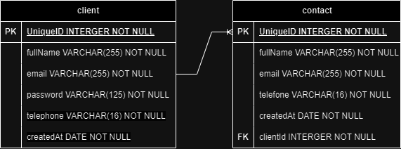

# API Contact Book

API REST para gerenciamento de uma agenda de contatos, desenvolvida em Node.js com TypeScript. O projeto demonstra cadastro e autenticação de usuários, validação de dados, persistência com PostgreSQL e relacionamento entre usuários e seus contatos.

## Visão geral

O sistema foi organizado em camadas:

- **Routers:** definição das rotas HTTP
- **Controllers:** entrada e saída das requisições
- **Services:** regras de autenticação e persistência
- **Middlewares:** validação do body e do token JWT
- **Schemas:** contrato e validação dos dados com Zod
- **Entities:** representação das tabelas com TypeORM
- **Migrations:** versionamento do banco de dados

Atualmente, a API disponibiliza o cadastro de clientes e autenticação por e-mail e senha. A entidade `Contact` e a tabela correspondente já existem no banco, mas as operações HTTP de CRUD de contatos ainda não estão implementadas.

## Tecnologias

- Node.js
- TypeScript
- Express
- TypeORM
- PostgreSQL
- Zod
- JSON Web Token
- bcrypt/bcryptjs
- dotenv

## Modelo de dados



- Um **Client** pode possuir vários **Contacts**
- Cada **Contact** pertence a um **Client**
- Os campos de e-mail são únicos
- O banco utiliza IDs numéricos gerados automaticamente

## Funcionalidades

- Cadastro de cliente
- Criptografia da senha com bcrypt
- Validação dos dados recebidos pela API
- Login com e-mail e senha
- Geração de token JWT
- Middleware preparado para validação de JWT
- Mapeamento do domínio com TypeORM
- Migrações para PostgreSQL
- Tratamento centralizado de erros

## Rotas disponíveis

| Método | Rota | Descrição | Autenticação |
|---|---|---|---|
| `POST` | `/clients` | Cadastra um novo cliente | Não |
| `POST` | `/login` | Autentica o cliente e retorna um JWT | Não |

### Cadastro

`POST /clients`

```json
{
  "fullName": "Maria Silva",
  "email": "maria@email.com",
  "password": "senha123",
  "telphone": "11999999999"
}
```

Resposta de sucesso:

```json
{
  "id": 1,
  "fullName": "Maria Silva",
  "email": "maria@email.com",
  "telphone": "11999999999",
  "createdAt": "2026-11-24"
}
```

### Login

`POST /login`

```json
{
  "email": "maria@email.com",
  "password": "senha123"
}
```

Resposta de sucesso:

```json
{
  "token": "eyJhbGciOiJIUzI1NiIsInR5cCI6IkpXVCJ9..."
}
```

Rotas protegidas deverão enviar o token no header:

```http
Authorization: Bearer <token>
```

## Como executar

### Pré-requisitos

- Node.js
- PostgreSQL
- npm

### 1. Instale as dependências

```bash
npm install
```

### 2. Configure o ambiente

Crie um arquivo `.env` a partir de `env.example`:

```bash
cp env.example .env
```

Configure os valores:

```env
DATABASE_URL=postgres://<username>:<password>@<host>:<port>/<database>
NODE_ENV=dev
SECRET_KEY=uma_chave_segura
EXPIRES=24h
PORT=3000
```

### 3. Execute as migrations

```bash
npm run typeorm migration:run -- -d src/data-source.ts
```

### 4. Inicie o servidor

```bash
npm run dev
```

Por padrão, a API ficará disponível em `http://localhost:3000`.

## Estrutura do projeto

```text
src/
├── controllers/  # Manipula requisições e respostas
├── entities/     # Entidades do banco de dados
├── interfaces/   # Tipos TypeScript derivados dos schemas
├── middlewares/  # Validações de body e autenticação
├── migrations/   # Histórico de alterações do banco
├── routers/      # Rotas da API
├── schemas/      # Contratos e validações Zod
└── services/     # Regras de negócio e acesso ao banco
```

## Próximos passos

- Implementar CRUD completo de contatos
- Adicionar relacionamento dos contatos ao cliente autenticado
- Proteger rotas de contatos com JWT
- Incluir testes automatizados
- Implementar paginação e filtros
- Documentar a API com Swagger/OpenAPI

## Autor

Projeto desenvolvido por [ja1rocambole](https://github.com/ja1rocambole).
